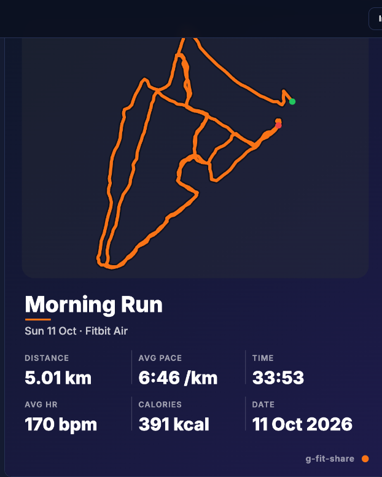
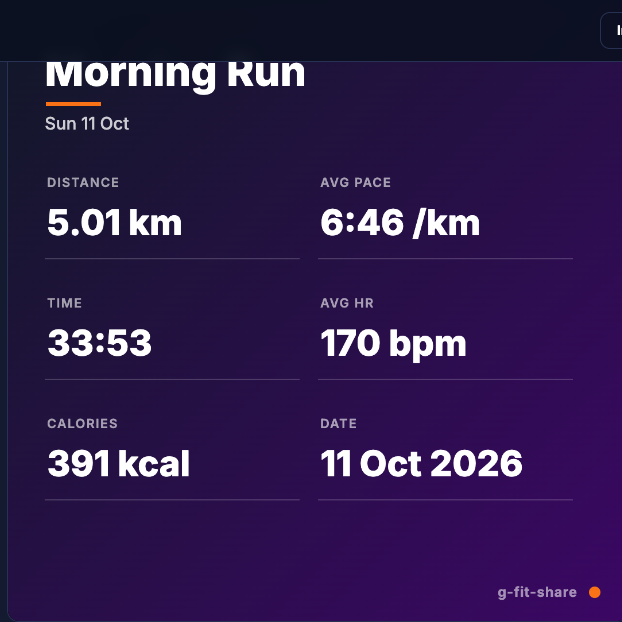
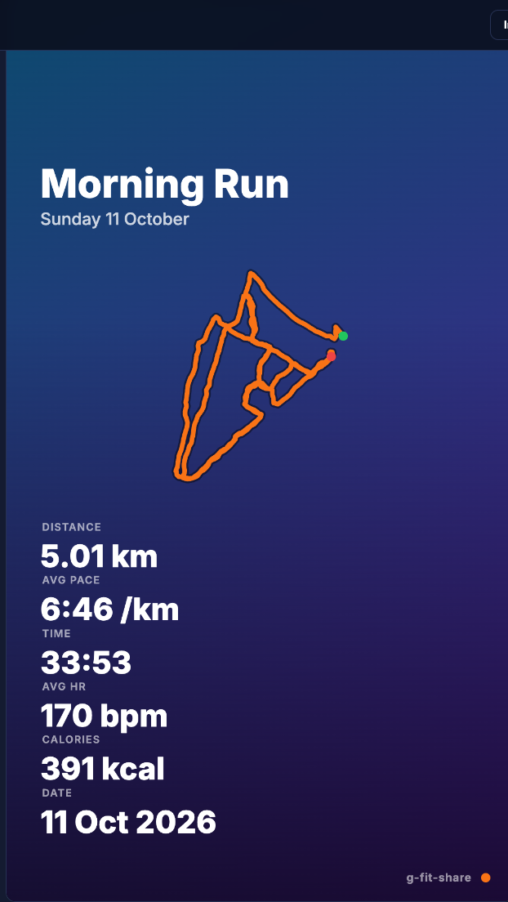

# g-fit-share

Turn a workout export into a Strava-style share image — in your browser, with your files never leaving your device.

Upload a `.tcx` file (Google Fit / Garmin export), pick a layout, choose which stats to show, add your own background photo, and export a PNG ready for Instagram, stories, or anywhere else.



## Features

- 📤 **Manual file upload** — drag & drop or browse. No accounts, no OAuth, no server.
- 🗺️ **Route map rendering** — your GPS track drawn as a crisp vector polyline. No map-tile service, works fully offline.
- 🖼️ **Template library** — three layouts out of the box:

  | Route Hero (4:5 feed post) | Stat Grid (1:1 square) | Story (9:16 vertical) |
  |---|---|---|
  |  |  |  |

- 🔢 **Pick your stats** — distance, pace, time, heart rate, calories, elevation, date. Minimal text style or boxed cards.
- 🎨 **Custom backgrounds** — upload a photo, tune the overlay and accent color, or export with a **transparent background** (alpha-preserving PNG, dark-ink mode for overlays).
- 📲 **Installable PWA** — offline-capable, add-to-homescreen, `Web Share` support on mobile.
- 🔌 **Extensible by design** — a canonical `StandardWorkout` model with per-format adapters, so new sources (GPX, FIT, Apple Health…) plug in without touching rendering code.
- 🪶 **Tiny** — vanilla TypeScript, zero runtime dependencies, ~7 KB gzipped JS.

## Quickstart

```sh
npm install
npm run dev      # http://localhost:5173
```

Click **Load sample run** to try it with a real 5K run (`public/sample.tcx`).

```sh
npm run build    # static output in dist/
npm run preview  # serve the production build
```

## Usage

1. **Upload** a `.tcx` activity file (or load the sample).
2. **Layout** — pick Route Hero, Stat Grid, or Story.
3. **Data** — toggle stats, edit the title, choose metric/imperial and Minimal/Cards style.
4. **Background** — upload a photo (saved locally in IndexedDB), adjust overlay/accent, or enable transparent export.
5. **Export** — Download PNG, Share (mobile), or Copy to clipboard.

## Privacy

Everything runs client-side. Your workout file is parsed in-memory in your browser and never uploaded anywhere. The only network request the app makes is the optional Google Fonts stylesheet (with a system-font fallback offline).

## Architecture

```
upload (.tcx) → adapters/tcx.ts → StandardWorkout (core/model.ts)
              → core/stats.ts (pace, splits, bbox, path simplification)
              → templates/* (route-hero 4:5 · stat-grid 1:1 · story 9:16)
              → canvas PNG → download / share / copy
```

- **Ingest:** each format implements `WorkoutAdapter { detect, parse }` (`src/core/model.ts`) and registers in `src/core/registry.ts`. v1 ships the TCX adapter.
- **Model:** `StandardWorkout { meta, summary, track[], laps[] }` with an open `Sport` union (`run | walk | ride | …`).
- **Rendering:** each template is a pure `(ctx, workout, opts) => void` function on a fixed-size canvas. The preview canvas and the export canvas run the same code, so what you see is what you get. Stats always end above a reserved footer strip where the watermark lives — they can't collide.
- **PWA:** `public/manifest.webmanifest` + `public/sw.js` (precache shell, offline fallback). The service worker registers in production builds only, so `npm run dev` never serves stale code.

## Project structure

```
src/
  main.ts            # app shell: ingest → customize → export (no framework)
  core/              # model.ts · registry.ts · stats.ts · units.ts
  adapters/          # tcx.ts (add gpx.ts, fit.ts, … here)
  templates/         # types.ts · registry.ts · route-hero.ts · stat-grid.ts · story.ts · helpers.ts
public/              # manifest, service worker, icons, sample.tcx
docs/                # screenshots used above
```

## Roadmap

- [ ] GPX adapter
- [ ] FIT adapter (WASM decoder)
- [ ] Apple Health export adapter
- [ ] Optional map-tile background layer (opt-in, online only)
- [ ] Split / heart-rate-zone charts as template blocks
- [ ] Multi-activity files (pick which activity to render)

## Contributing

See [CONTRIBUTING.md](CONTRIBUTING.md). TL;DR: vanilla TS, zero runtime deps, keep the bundle tiny, one focused PR at a time with screenshots for visual changes.

## Hosting

`dist/` is plain static files — deploy to GitHub Pages, Cloudflare Pages, Netlify, or any file host. Serve over HTTPS for PWA install and `navigator.share`.

## License

[MIT](LICENSE) © 2026 Ananthu Kanive
